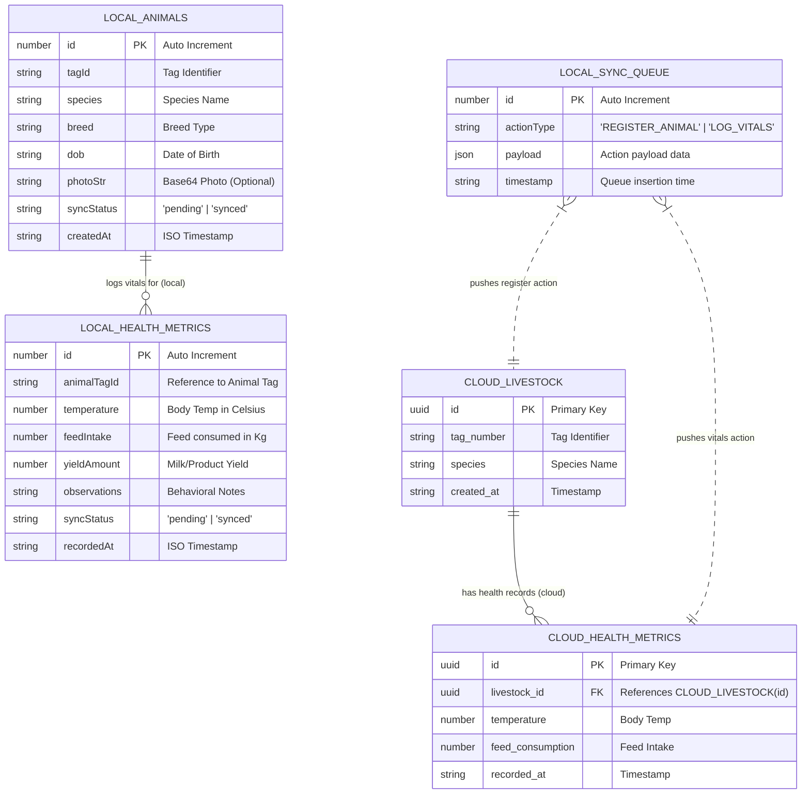

# AgriHerd - Technical Documentation & Progress Report

Welcome to the comprehensive technical documentation for **AgriHerd**, an industrial-grade, offline-first livestock management application designed for modern agricultural operations.

---

## 📋 Table of Contents
1. [Project Overview & Architecture](#-project-overview--architecture)
2. [Project Work Progress](#-project-work-progress)
3. [Use Cases](#-use-cases)
4. [Entity-Relationship (ER) Diagram](#-entity-relationship-er-diagram)
5. [How the Backend Works](#-how-the-backend-works)
   - [Offline-First Local Storage Engine](#1-offline-first-local-storage-engine-dexiejs)
   - [Sync Queue Processing Engine](#2-sync-queue-processing-engine)
   - [Self-Healing Schema Recovery Algorithm](#3-self-healing-schema-recovery-algorithm)
   - [Cloud Hydration Pipeline](#4-cloud-hydration-pipeline)
6. [API & Interface Reference](#-api--interface-reference)

---

## 🏗 Project Overview & Architecture

AgriHerd is engineered as an **Offline-First Web Application** to function reliably in agricultural field environments with zero or intermittent internet access.

```
       +-------------------------------------------------------------+
       |                         USER UI                             |
       |  (Next.js App Router, Tailwind CSS, Dexie Live Hooks)       |
       +------------------------------+------------------------------+
                                      |
                               Read / | Write
                                      v
       +-------------------------------------------------------------+
       |               LOCAL INDEXEDDB (Dexie.js)                    |
       |  - animals (Local Storage)                                  |
       |  - healthMetrics (Local Vitals & Yield)                     |
       |  - syncQueue (Pending Cloud Mutations)                      |
       +------------------------------+------------------------------+
                                      |
                           Background | Sync Engine
                                      v
       +-------------------------------------------------------------+
       |                 SUPABASE CLOUD BACKEND                      |
       |  - livestock (PostgreSQL Table)                             |
       |  - health_metrics (PostgreSQL Table)                        |
       +-------------------------------------------------------------+
```

---

## 🚀 Project Work Progress

### 1. Core Framework & UI Foundation
- **Next.js 16 (App Router)**: Structured with modular app directories (`/dashboard`, `/dashboard/livestock`, `/dashboard/records`, `/dashboard/analytics`).
- **Industrial Design System**: Modern green/emerald themed UI with glassmorphism, responsive sidebar navigation, and card-based metrics.
- **Component Suite**: Reusable UI components powered by Tailwind CSS v4, Lucide React icons, and Radix/Base UI primitives.

### 2. Local Storage Implementation (`Dexie.js`)
- Configured IndexedDB using `Dexie.js` in `lib/db.ts`.
- Schema Version 2 defined with stores: `animals`, `healthMetrics`, and `syncQueue`.
- Integrated `dexie-react-hooks` (`useLiveQuery`) for real-time reactivity in UI components.

### 3. Dynamic Dashboard Overview
- Integrated live reactive queries on the main dashboard (`app/dashboard/page.tsx`).
- Automatically computes active herd count and real-time total daily yield from local IndexedDB data without requiring server round-trips.

### 4. Animal Registration & Vitals Logging
- **Animal Registration Form** (`/dashboard/livestock/new`): Captures tag ID, species, breed, and date of birth (DOB). Writes immediately to local storage and pushes action to `syncQueue`.
- **Health & Production Logging Form** (`/dashboard/records`): Captures body temperature, feed intake, daily milk/milk-equivalent yield, and behavioral observations.

### 5. Backend Sync & Schema Resilience Engine (`lib/sync.ts`)
- **Background Queue Execution**: Automatically runs when the dashboard mounts or when the browser regains an internet connection (`window.onLine`).
- **Resilient Column Stripping**: Traps Supabase PostgREST `PGRST204` schema cache errors (e.g. missing `dob` or `breed` columns) and iteratively strips un-cached payload fields to ensure successful inserts.
- **Dual Tag Mapping**: Automatically handles differences between cloud `tag_number` and `tag_id` schemas.
- **Cloud Hydration**: Implemented `hydrateLocalDatabase()` to pull remote livestock down to local IndexedDB upon reconnection.

---

## 🎯 Use Cases

### UC-1: Register New Animal (Offline/Online)
- **Actor**: Farm Worker / Herd Manager.
- **Precondition**: User is on the "Register Animal" page (`/dashboard/livestock/new`).
- **Flow**:
  1. User fills out Tag ID, Species, Breed, and Date of Birth.
  2. System creates a record in IndexedDB (`animals` table) with `syncStatus: 'pending'`.
  3. System creates a `REGISTER_ANIMAL` action in `syncQueue`.
  4. System redirects user to Livestock Directory with zero wait time.

### UC-2: Log Daily Vitals and Production Metrics
- **Actor**: Field Technician.
- **Precondition**: User is on the "New Log Entry" page (`/dashboard/records`).
- **Flow**:
  1. User inputs Tag ID, Body Temperature (°C), Feed Intake (kg), Daily Yield (L/kg), and behavioral notes.
  2. System stores metric entry in IndexedDB (`healthMetrics` table) with `syncStatus: 'pending'`.
  3. System queues a `LOG_VITALS` action in `syncQueue`.
  4. Dashboard calculations (Total Daily Yield) update instantaneously via live queries.

### UC-3: Background Offline-to-Cloud Sync
- **Actor**: Background System Service.
- **Trigger**: Browser triggers `online` event or Dashboard layout mounts.
- **Flow**:
  1. `processSyncQueue()` checks `navigator.onLine`.
  2. Reads all pending actions from IndexedDB `syncQueue`.
  3. Sequentially attempts to upload records to Supabase.
  4. On successful insert, updates local record `syncStatus` to `'synced'` and removes action from `syncQueue`.
  5. On failure due to schema mismatches, applies self-healing column fallback.

### UC-4: Cloud Data Hydration
- **Actor**: Background System Service.
- **Trigger**: Following successful sync execution.
- **Flow**:
  1. `hydrateLocalDatabase()` queries Supabase `livestock` table using `.select('*')`.
  2. Maps cloud records (`tag_number`, `species`, `created_at`) into local Dexie entity format.
  3. Replaces synced records in local IndexedDB to keep field devices synchronized with cloud state.

---

## 📊 Entity-Relationship (ER) Diagram



### Table Definitions & Field Mapping

| Context | Table Name | Key Fields | Description |
| :--- | :--- | :--- | :--- |
| **Local (Dexie)** | `animals` | `id`, `tagId`, `species`, `breed`, `dob`, `syncStatus` | Primary local store for livestock entities. |
| **Local (Dexie)** | `healthMetrics` | `id`, `animalTagId`, `temperature`, `feedIntake`, `yieldAmount`, `syncStatus` | Local store for health & production metrics. |
| **Local (Dexie)** | `syncQueue` | `id`, `actionType`, `payload`, `timestamp` | Queue for pending cloud operations. |
| **Cloud (Supabase)** | `livestock` | `id`, `tag_number`, `species`, `created_at` | Supabase cloud table for livestock. |
| **Cloud (Supabase)** | `health_metrics` | `id`, `livestock_id`, `temperature`, `feed_consumption`, `recorded_at` | Supabase cloud table for vitals. |

---

## ⚙️ How the Backend Works

AgriHerd uses a hybrid **Local-First Architecture** where client-side IndexedDB serves as the primary database for reads and writes, while Supabase acts as the remote persistence layer.

### 1. Offline-First Local Storage Engine (`Dexie.js`)
When users perform any action (such as adding an animal or logging vitals), the application **does not send an immediate HTTP request to the cloud server**. Instead:
1. Data is saved synchronously to browser storage (`IndexedDB`) via `Dexie`.
2. UI updates immediately via `useLiveQuery` hooks without network latency or risk of dropped requests due to bad cellular signal.

```typescript
// Example: Immediate local write in app/dashboard/livestock/new/page.tsx
const localId = await db.animals.add(newAnimal)
await db.syncQueue.add({
  actionType: 'REGISTER_ANIMAL',
  payload: { ...newAnimal, localId },
  timestamp: new Date().toISOString()
})
```

---

### 2. Sync Queue Processing Engine
The background sync queue (`lib/sync.ts`) processes pending actions sequentially when the application is online.

```
                  +--------------------------+
                  |  Check navigator.onLine  |
                  +------------+-------------+
                               |
                        Online |
                               v
                  +--------------------------+
                  | Fetch syncQueue items    |
                  +------------+-------------+
                               |
                               v
            +----------------------------------+
            |  Process Action (REGISTER/LOG)   |
            +------------------+---------------+
                               |
                     Success   |   Failure (Schema Error)
                        +------+------+
                        |             |
                        v             v
             +------------------+  +-------------------------------+
             | Mark local status|  | Self-Healing Schema Fallback  |
             | as 'synced' and  |  | Strip missing column & retry  |
             | delete queue item|  +-------------------------------+
             +------------------+
```

---

### 3. Self-Healing Schema Recovery Algorithm
Cloud database schemas in production environments often differ from local application payloads (e.g., optional columns like `dob` or `breed` not yet migrated on the remote table).

To prevent sync queue lockups, `processSyncQueue` implements an **automated schema recovery loop**:

```typescript
// Excerpt from lib/sync.ts
let error: any = null

while (true) {
  const result = await supabase
    .from('livestock')
    .insert([insertPayload])

  error = result.error
  if (!error) break // Insertion successful

  // Intercept Supabase PGRST204 errors: "Could not find the 'xyz' column of 'livestock' in the schema cache"
  const missingColMatch = error.message?.match(/Could not find the '([^']+)' column/i)
  if (missingColMatch && missingColMatch[1] && missingColMatch[1] in insertPayload) {
    const missingCol = missingColMatch[1]
    console.warn(`Supabase 'livestock' table lacks '${missingCol}' column. Retrying insert without it...`)
    delete insertPayload[missingCol] // Prune un-cached column
  } else {
    break // Non-schema error, abort to prevent infinite loop
  }
}
```

#### How it Resolves Mismatches:
- If Supabase returns `Could not find the 'tag_id' column...`, the engine prunes `tag_id` and keeps `tag_number`.
- If Supabase returns `Could not find the 'dob' column...`, the engine prunes `dob` and retries.
- Once payload matches the target Supabase schema, insert succeeds and the queue item is removed.

---

### 4. Cloud Hydration Pipeline
When the user connects online, `hydrateLocalDatabase()` pulls all cloud records to update local storage:

```typescript
export async function hydrateLocalDatabase() {
  if (!navigator.onLine) return

  const { data: cloudLivestock, error } = await supabase
    .from('livestock')
    .select('*')

  if (cloudLivestock && cloudLivestock.length > 0) {
    const localReadyAnimals = cloudLivestock.map(animal => ({
      tagId: animal.tag_number || animal.tag_id || 'UNKNOWN',
      species: animal.species,
      breed: animal.breed || 'Unknown',
      dob: animal.dob || animal.date_of_birth || animal.birth_date || new Date().toISOString(),
      syncStatus: 'synced' as const,
      createdAt: animal.created_at
    }))

    await db.transaction('rw', db.animals, async () => {
      await db.animals.where('syncStatus').equals('synced').delete()
      await db.animals.bulkAdd(localReadyAnimals)
    })
  }
}
```

---

## 🛠 Summary of Tech Stack

| Layer | Technology |
| :--- | :--- |
| **Frontend Framework** | Next.js 16 (App Router), React 19, TypeScript |
| **Styling & UI** | Tailwind CSS v4, Lucide Icons, Shadcn UI primitives |
| **Client Storage** | Dexie.js (IndexedDB abstraction layer) |
| **State Reactivity** | `dexie-react-hooks` (`useLiveQuery`) |
| **Cloud Backend** | Supabase (PostgreSQL, PostgREST API) |
| **Sync Strategy** | Local-First Event Queue with Self-Healing Schema Recovery |

---
*Document updated automatically on 2026-08-18.*
